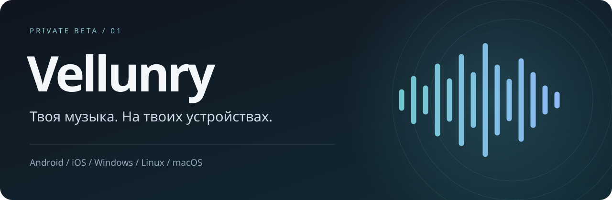
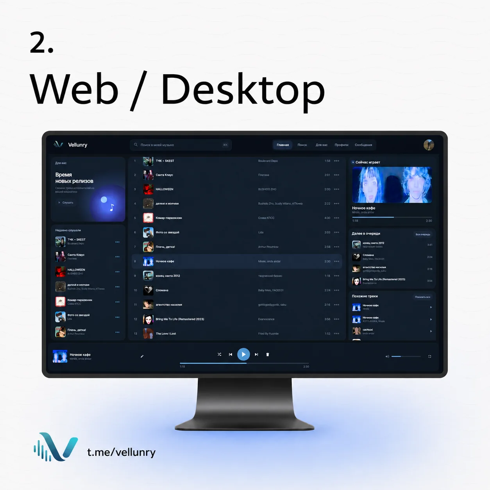
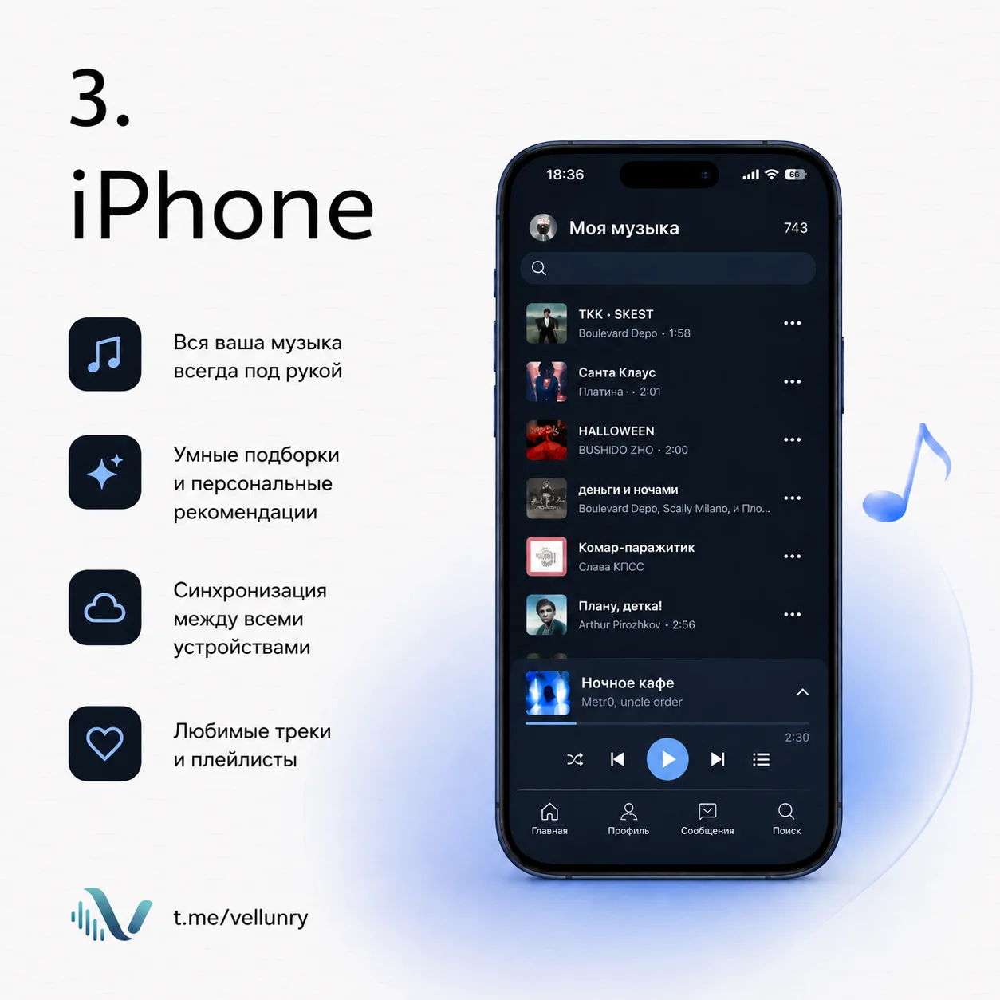

  <a href="https://vellunry.ru">Открыть веб-плеер</a> ·
  <a href="https://github.com/saslekawaiii/vellunry-releases/releases">Скачать приложение</a> ·
  <a href="https://t.me/vellunry">Новости</a> ·
  <a href="INSTALL.md">Установка</a>

## Музыка остаётся с тобой

**Vellunry** — онлайн-плеер с личной картотекой, персональными миксами,
плейлистами и текстами песен. Приложения открывают тот же сервис, что и браузер:
один аккаунт, привычный интерфейс, обновления без переустановки клиента.

Здесь находятся **готовые установщики и инструкции**, а не исходники сервиса.
Репозиторий пока закрыт: ссылки доступны только приглашённым участникам.

## Выбери своё устройство

| Устройство | Скачать бета-версию | Что нужно знать |
| :--- | :--- | :--- |
| Android 8+ | [APK](https://github.com/saslekawaiii/vellunry-releases/releases/download/v0.1.0-beta.1/Vellunry-0.1.0-beta.1-android.apk) | Подписан постоянным ключом Vellunry. Нужен современный браузер с поддержкой TWA. |
| Windows, x64 | [Установщик EXE](https://github.com/saslekawaiii/vellunry-releases/releases/download/v0.1.0-beta.1/Vellunry-0.1.0-beta.1-win-x64.exe) | Бета без коммерческой подписи; возможен запрос SmartScreen. |
| macOS, Apple Silicon | [DMG для M1/M2/M3/M4 и новее](https://github.com/saslekawaiii/vellunry-releases/releases/download/v0.1.0-beta.1/Vellunry-0.1.0-beta.1-mac-arm64.dmg) | Не нотарифицирован Apple. |
| macOS, Intel | [DMG для Intel](https://github.com/saslekawaiii/vellunry-releases/releases/download/v0.1.0-beta.1/Vellunry-0.1.0-beta.1-mac-x64.dmg) | Не нотарифицирован Apple. |
| Linux, x64 | [AppImage](https://github.com/saslekawaiii/vellunry-releases/releases/download/v0.1.0-beta.1/Vellunry-0.1.0-beta.1-linux-x64.AppImage) · [DEB](https://github.com/saslekawaiii/vellunry-releases/releases/download/v0.1.0-beta.1/Vellunry-0.1.0-beta.1-linux-x64.deb) | Для Debian/Ubuntu есть обычный пакет; AppImage требует совместимого окружения. |
| iPhone / iPad, iOS 15+ | [IPA для переподписи](https://github.com/saslekawaiii/vellunry-releases/releases/download/v0.1.0-beta.1/Vellunry-0.1.0-beta.1-ios-unsigned.ipa) | **Неподписанный IPA.** Перед установкой нужна личная подпись через Sideloadly/AltStore. Это не TestFlight и не App Store. |

[Все файлы релиза](https://github.com/saslekawaiii/vellunry-releases/releases/tag/v0.1.0-beta.1) ·
[Проверить SHA-256](https://github.com/saslekawaiii/vellunry-releases/releases/download/v0.1.0-beta.1/SHA256SUMS.txt)

## Один сервис, разные экраны

| На компьютере | На телефоне |
| :---: | :---: |
|  |  |

Иллюстрации онлайн-сервиса. Интерфейс, каталог и рекомендации обновляются на сайте
и могут отличаться от показанных экранов.

## Что проверить в бете

- Вход в свой аккаунт через Telegram и открытие картотеки.
- Поиск, профили исполнителей, альбомы и добавление треков.
- Плейлисты и восемь персональных миксов.
- Воспроизведение, перемотку, следующий трек и управление системой.
- Поведение при сворачивании, блокировке экрана и потере сети.

Это первая закрытая бета оболочек. Фоновое воспроизведение, системные кнопки
и офлайн-возможности зависят от платформы и требуют проверки на реальных
устройствах. Полный нативный офлайн-плеер этими сборками не заявляется.

## Обратная связь

Нашёл ошибку? [Создай issue](https://github.com/saslekawaiii/vellunry-releases/issues/new?template=bug_report.yml)
или напиши [в поддержку](https://t.me/saslekawaiii). Укажи устройство, ОС,
версию клиента и действия, после которых появилась проблема.

**Не прикладывай пароли, коды входа, токены и личную переписку.**
О проблемах безопасности сообщай приватно: [SECURITY.md](SECURITY.md).

---

Copyright 2026 Vellunry. Все права защищены. Vellunry не объявляется open source.
Сторонние компоненты сохраняют собственные лицензии.
