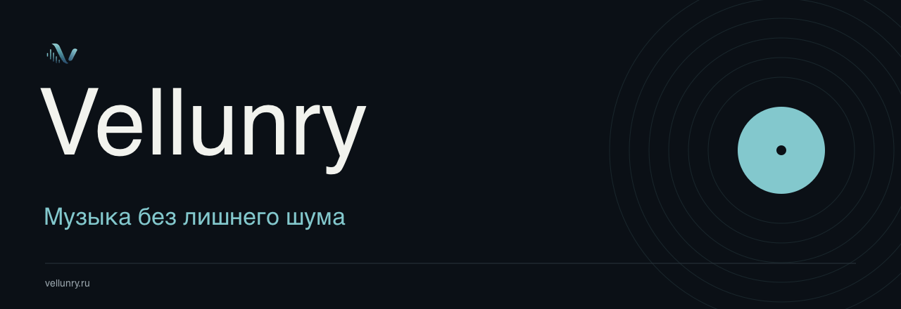
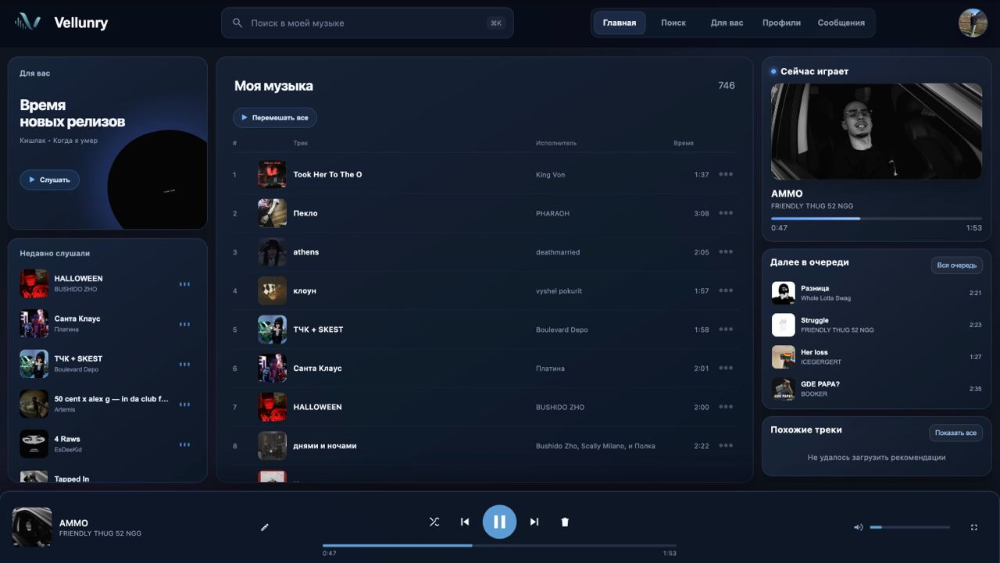

  <a href="https://vellunry.ru/mysongs">Открыть плеер ↗</a> &nbsp; / &nbsp;
  <a href="https://t.me/vellunry">Telegram ↗</a> &nbsp; / &nbsp;
  <a href="INSTALL.md">Установка</a> &nbsp; / &nbsp;
  <a href="INSIDE.md">Что внутри</a>

Vellunry — музыкальный сервис с личной картотекой, плейлистами,
рекомендациями и текстами песен. Работает в браузере и приложениях.

## Скачать

Бета **0.1.0** · [Все файлы релиза](https://github.com/saslekawaiii/vellunry-releases/releases/tag/v0.1.0-beta.1)

| Система | Установщик |
| :--- | :--- |
| Android 8+ | [APK](https://github.com/saslekawaiii/vellunry-releases/releases/download/v0.1.0-beta.1/Vellunry-0.1.0-beta.1-android.apk) |
| Windows · x64 | [EXE](https://github.com/saslekawaiii/vellunry-releases/releases/download/v0.1.0-beta.1/Vellunry-0.1.0-beta.1-win-x64.exe) |
| macOS · Apple Silicon | [DMG](https://github.com/saslekawaiii/vellunry-releases/releases/download/v0.1.0-beta.1/Vellunry-0.1.0-beta.1-mac-arm64.dmg) |
| macOS · Intel | [DMG](https://github.com/saslekawaiii/vellunry-releases/releases/download/v0.1.0-beta.1/Vellunry-0.1.0-beta.1-mac-x64.dmg) |
| Linux · x64 | [AppImage](https://github.com/saslekawaiii/vellunry-releases/releases/download/v0.1.0-beta.1/Vellunry-0.1.0-beta.1-linux-x64.AppImage) · [DEB](https://github.com/saslekawaiii/vellunry-releases/releases/download/v0.1.0-beta.1/Vellunry-0.1.0-beta.1-linux-x64.deb) |
| iPhone и iPad · iOS 15+ | [IPA для переподписи](https://github.com/saslekawaiii/vellunry-releases/releases/download/v0.1.0-beta.1/Vellunry-0.1.0-beta.1-ios-unsigned.ipa) |

**Перед установкой:** Windows-сборка без подписи издателя; macOS-сборки
без нотарификации Apple. IPA нельзя установить напрямую из Safari —
нужна переподпись. [Подробная инструкция](INSTALL.md).

[Контрольные суммы SHA-256](https://github.com/saslekawaiii/vellunry-releases/releases/download/v0.1.0-beta.1/SHA256SUMS.txt)

## Плеер

Это скриншот веб-интерфейса. Приложения подключаются к тому же сервису;
интерфейс обновляется на сайте. Фоновое воспроизведение и системное управление
пока проверяются на разных устройствах. Нативный офлайн-плеер не заявляется.

## Обратная связь

[Сообщить об ошибке](https://github.com/saslekawaiii/vellunry-releases/issues/new?template=bug_report.yml)
или [написать в поддержку](https://t.me/saslekawaiii).
Укажи устройство, версию ОС и что произошло. Не прикладывай пароли и коды входа.

---

© 2026 Vellunry. Этот репозиторий содержит установщики и документацию.
Исходники сервиса не публикуются. [Лицензия](LICENSE) · [Безопасность](SECURITY.md)
